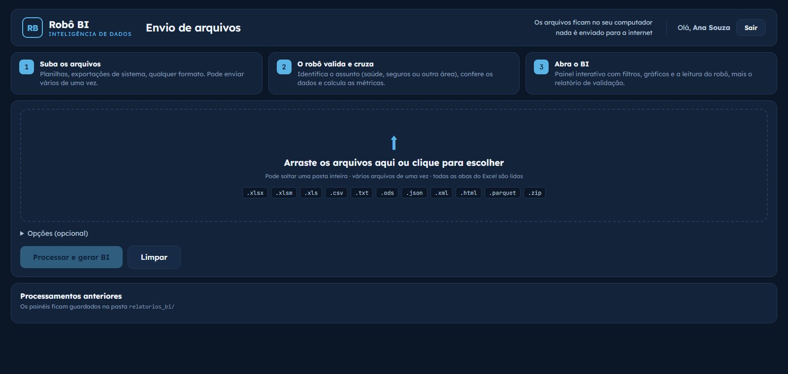
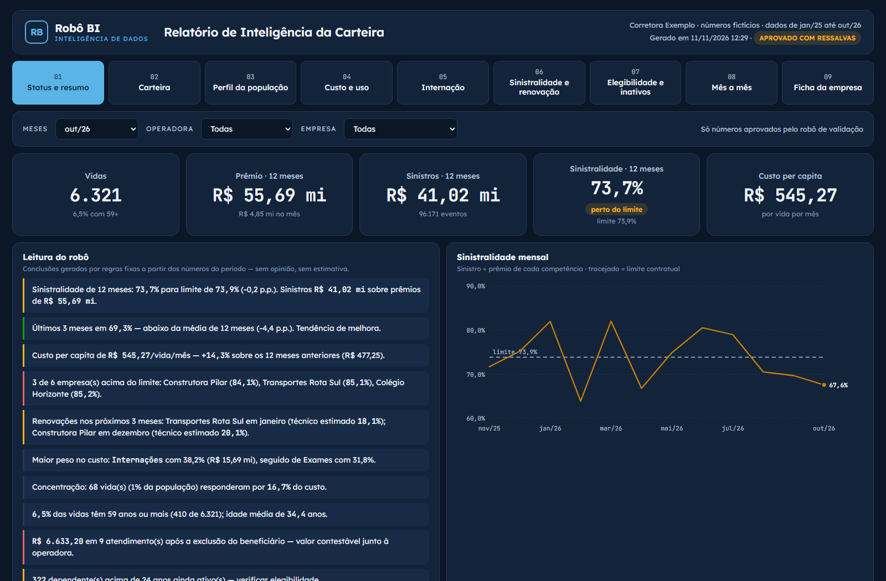
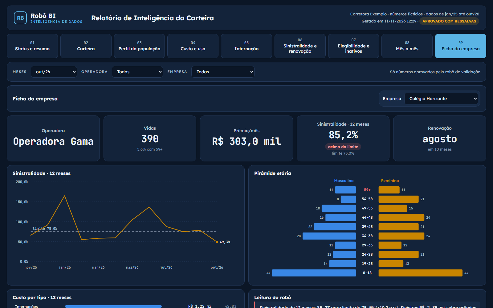
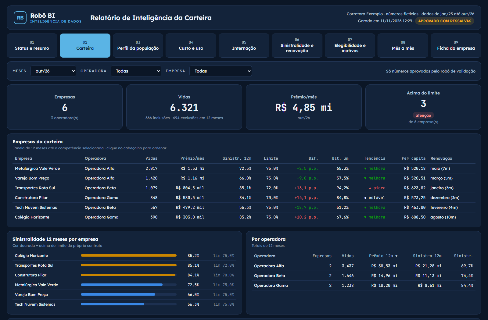
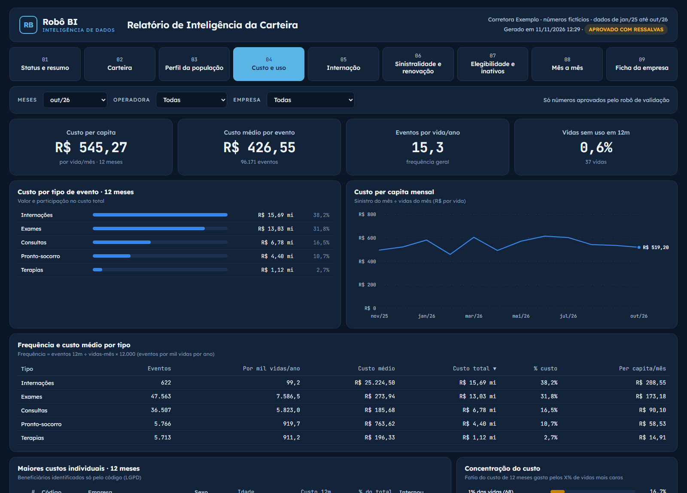
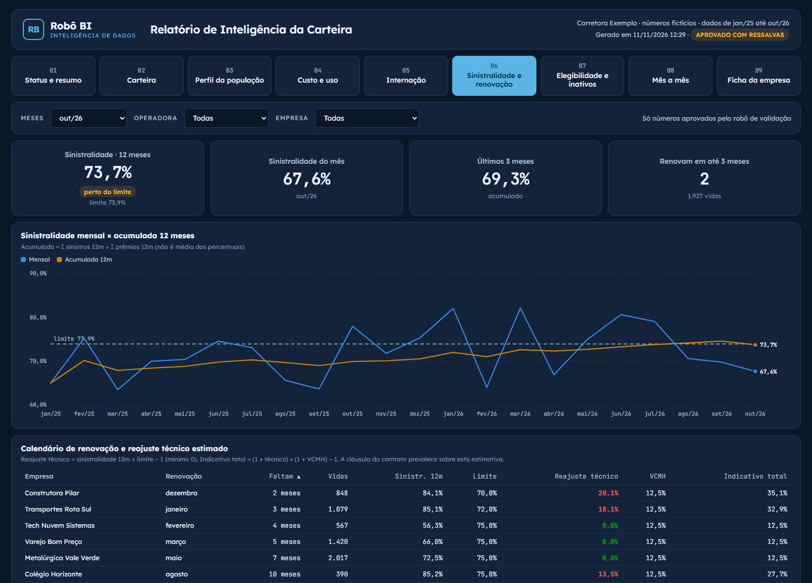
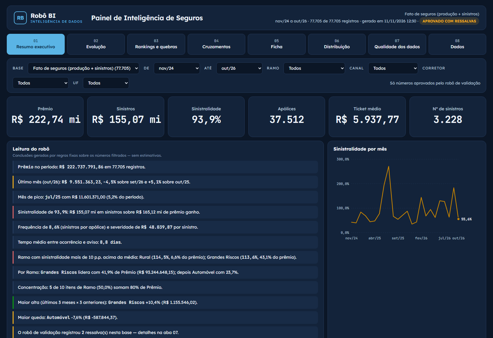
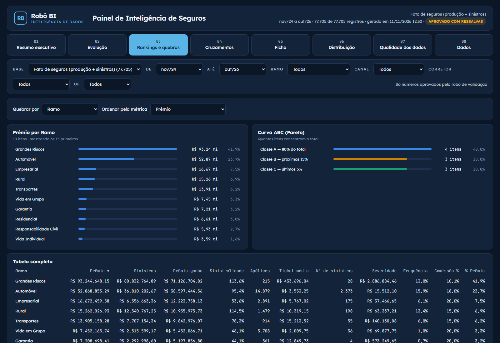
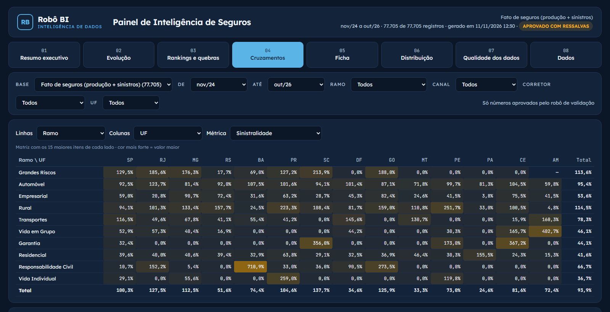
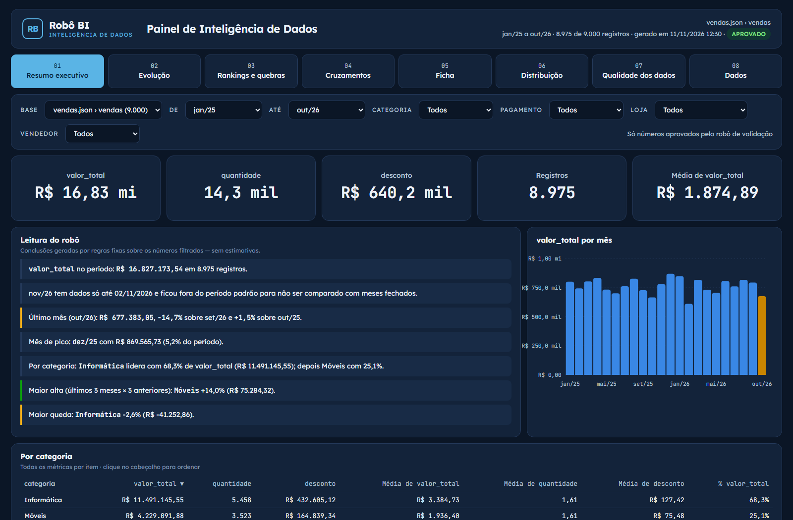

# Robô BI

**Você sobe os arquivos e o robô entrega o BI.** Ele lê planilhas e exportações de sistema em qualquer formato, descobre sozinho do que se tratam (plano de saúde, seguros multirramo ou qualquer outra área), valida os dados, cruza as métricas e gera painéis interativos prontos para apresentar.

Feito em Python puro, sem dependências obrigatórias. Roda no seu computador e os arquivos não vão para a internet.



---

## Login e cadastro

O acesso é protegido por login. Na primeira vez, crie a conta na aba **Criar conta** (nome, empresa opcional, e-mail e senha). Depois é só entrar com e-mail e senha.


<p align="center"></p>

- Senhas guardadas com criptografia (scrypt com sal), nunca em texto puro.
- A sessão expira em 12 horas, e o botão **Sair** encerra na hora.
- Muitas tentativas erradas seguidas fazem o login esperar alguns minutos, sem travar a conta.
- Usuários e sessões ficam em `dados_bi/acesso.db`, só no seu computador.

## Como funciona

1. **Suba os arquivos** na tela de envio: arraste planilhas, CSVs, uma pasta inteira ou um `.zip`.
2. **O robô valida e cruza**: identifica o assunto pelo conteúdo das colunas, confere cada linha e calcula as métricas do setor.
3. **Abra o BI**: painéis com filtros, gráficos, a "leitura do robô" e o relatório de validação.

## Painel de plano de saúde

Gerado quando o robô encontra **beneficiários + faturamento + sinistros**. São 9 abas: status e resumo, carteira, perfil da população, custo e uso, internação, sinistralidade e renovação, elegibilidade e inativos, mês a mês e ficha da empresa.











## Painel de seguros multirramo

Para vida, auto, residencial, empresarial, grandes riscos, rural, transportes, RC, garantia e outros. O robô junta **produção e sinistros**, mesmo vindos de arquivos diferentes, e calcula:

- sinistralidade sobre **prêmio ganho pro rata die**
- frequência e severidade
- ticket médio, comissão %, taxa média
- tempo de aviso e índice combinado

Tudo pode ser quebrado por ramo, UF, canal, corretor, causa e situação do sinistro.







## Painel geral (qualquer área)

Para vendas, financeiro, RH, estoque ou o que vier. O robô classifica cada coluna (data, número, categoria, identificador, texto) e monta:

- KPIs com variação
- evolução mensal, trimestral e anual comparada ao ano anterior
- rankings e curva ABC
- matriz de cruzamento e ficha por item
- distribuição e qualidade dos dados
- exportação em CSV



*Todas as imagens usam dados fictícios gerados pelo próprio robô (`--exemplo`).*

---

## Instalação e uso

Requer **Python 3.10+**. Não precisa instalar nenhum pacote.

```bash
git clone https://github.com/RodrigoAp727/gerador-relatorios.git
cd gerador-relatorios
python servidor_bi.py
```

O navegador abre em `http://127.0.0.1:8765` na tela de login. Na primeira vez, crie sua conta na aba **Criar conta**; depois é só entrar com e-mail e senha. Os usuários ficam em `dados_bi/acesso.db`, só no seu computador. No Windows, também dá para usar duplo clique em **`ROBO_BI.bat`**.

Para testar sem dados próprios:

```bash
python rodar_robo.py --exemplo --abrir
```

Pela linha de comando:

```bash
python rodar_robo.py PASTA_OU_ARQUIVO --saida relatorios_bi --abrir
```

Opções: `--corretora "Nome"` · `--marca "Sua Marca"` · `--limite 75` · `--vcmh 12.5` · `--idade-dependente 24`

## Formatos lidos

| Formato | Observação |
|---|---|
| `.xlsx` `.xlsm` `.xltx` | todas as abas; acha o cabeçalho mesmo com título em cima; ignora linha de "Total" |
| `.csv` `.txt` `.tsv` `.dat` | detecta separador e encoding |
| `.ods` | LibreOffice / Google Planilhas |
| `.json` `.jsonl` | listas de objetos, campos aninhados |
| `.xml` `.html` | registros repetidos e tabelas (inclusive ".xls" exportado como HTML) |
| `.zip` | descompactado automaticamente na tela de envio |
| `.xls` antigo | `pip install xlrd` |
| `.parquet` `.feather` `.sav` `.dta` | `pip install pandas pyarrow` |

## Por que os números são concretos

- **Nada é estimado, interpolado ou inventado.** Se falta um dado, aparece "—" e o motivo vai para a validação.
- **Razões são sempre soma ÷ soma** no período, nunca média de percentuais.
- **O robô de validação** conta e explica cada linha descartada: data inválida, ID duplicado, valor ilegível, sinistro sem cadastro, atendimento após a exclusão, grafias diferentes da mesma categoria.
- **O mês incompleto** no fim da série fica fora das comparações automaticamente.
- **A "leitura do robô"** é feita por regras fixas: cada frase traz o número que a sustenta.
- **Testes conferem os números** contra um cálculo independente feito nos arquivos brutos:

```bash
python tests/test_robo_bi.py
```

## Estrutura

```
servidor_bi.py         tela de envio (servidor local, com login)
rodar_robo.py          linha de comando
ROBO_BI.bat            atalho Windows
robo_bi/acesso.py      login, cadastro e sessões (SQLite local)
robo_bi/formatos.py    leitor universal de arquivos
robo_bi/leitura.py     normalização de números, datas e nomes + classificação de saúde
robo_bi/motor.py       saúde: validação e cruzamento beneficiário a beneficiário
robo_bi/seguros.py     seguros multirramo: mapeamento semântico, fato unificado, prêmio ganho
robo_bi/generico.py    BI automático para qualquer tabela + qualidade dos dados
robo_bi/robo.py        orquestração e geração dos painéis
robo_bi/web/           layout, gráficos e telas
robo_bi/exemplo.py     gerador de dados fictícios
tests/test_robo_bi.py  testes de conferência
```

## Limites conhecidos

- O painel geral analisa até 250 mil linhas por base. Acima disso o robô avisa e não analisa o excedente.
- O robô não estima sinistros ocorridos e ainda não avisados (IBNR). Ele só avisa que os meses recentes podem estar incompletos.
